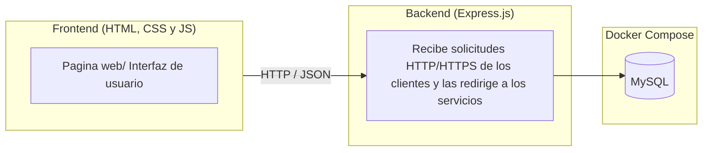
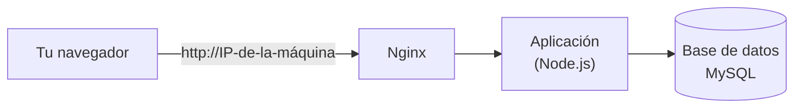

# Proyecto_SED_02-26

# Descripcion: 
La página web desarrollada consiste en una plataforma de comercio electrónico enfocada en la compra y venta de ropa de segunda mano, cuyo principal objetivo es la reducción del desperdicio textil mediante la reutilización de prendas en buen estado que ya no son utilizadas por sus propietarios.

La plataforma permite que los usuarios participen tanto como vendedores y compradores, ofreciendo un espacio digital accesible en el que puedan publicar, consultar y adquirir diferentes prendas de vestir.

Para realizar ventas, los usuarios deben registrarse e iniciar sesión en la plataforma. Posteriormente, pueden acceder a la sección de productos y completar un formulario en el que proporcionan información relevante sobre las prendas que desean ofrecer y una imagen representativa del producto.

Por otra parte, los usuarios interesados en adquirir ropa pueden explorar el catálogo disponible, consultar las características de cada producto y agregarlos a un carrito de compras. Una vez seleccionados los artículos se procede con el proceso de compra donde se genera una factura que detalla los productos adquiridos y el monto total de la operación.


El sistema incluye los siguientes __roles:__
1. *Usuario publico:* accede a la pagina sin necesidad de registrarse o de inciar sesión, puede visualizar de forma general el sitio y consultar información básica.
2. *Vendedor:* tiene acceso a funcionalidades de compra y venta; puede publicar ropa a partir de un formulario donde proporciona especificaciones del producto, agregar al carrito de compras y realizar pedidos.
3. *Admin:* tiene acceso a funcionalidades adminsitrativas que le permite supervisar y gestionar su funcionamiento. Se encarga de administrar usuarios, gestión de productos y control de la inforamción almacenada en el sistema.

# Arquitectura:



1. __Tecnologias:__ 
Express.js, Node.js, Docker, Javascript

2. __Base de datos:__ MySQL

3. __Estructura carpetas:__
```text
proyecto
├── 📁 backend/
│   ├── ⚙️ config/
│   │   └── database.js
│   ├── 🎮 controllers/
│   │   ├── adminController.js
│   │   ├── carritoController.js
│   │   ├── pedidosController.js
│   │   ├── productosController.js
│   │   ├── stockController.js
│   │   └── validacionProducto.js
│   ├──  🗃️  db/
│   │   ├── migracion_roles.sql
│   │   ├── pedidos_factura.sql
│   │   └── tienda_ropa.sql
│   ├── 🛡️ middleware/
│   │   ├── auth.js
│   │   └── upload.js
│   ├── 🛣️ routes/
│   │   ├── admin.js
│   │   ├── carrito.js
│   │   ├── pedidos.js
│   │   ├── productos.js
│   │   └── stocke.js
│   └── 🔧 scripts/
│       └── crear-admin.js
│
├── 🎨 frontend/
│   ├── 🖼️ assets/
│   │   ├── 🔣 icons/
│   │   │   ├── footer/
│   │   │   │   ├── facebook.svg
│   │   │   │   ├── instagram.svg
│   │   │   │   └── pinterest.svg
│   │   │   ├── home/
│   │   │   │   └── add-cart.svg
│   │   │   ├── navigation/
│   │   │   │   ├── cart.svg
│   │   │   │   ├── search.svg
│   │   │   │   └── user.svg
│   │   │   ├── sell-page/
│   │   │   │   └── user.svg
│   │   │   ├── sell-panel/
│   │   │   │   ├── create.svg
│   │   │   │   ├── dashboard.svg
│   │   │   │   ├── edit-profile.svg
│   │   │   │   └── stock.svg
│   │   │   ├── shoppingCart/
│   │   │   │   ├── cart-arrow.svg
│   │   │   │   ├── cart-check.svg
│   │   │   │   ├── cart-plus.svg
│   │   │   │   ├── cart.svg
│   │   │   │   └── trash.svg
│   │   │   └── .gitkeep
│   │   └── 🌄 images/
│   │       ├── banner/
│   │       │   ├── banner1.jpg
│   │       │   ├── banner2.jpg
│   │       │   └── banner3.jpg
│   │       ├── home/
│   │       │   ├── hero1.jpg
│   │       │   └── hero2.jpg
│   │       ├── logo/
│   │       │   ├── logo-loop-horizontal.svg
│   │       │   └── logo-loop.svg
│   │       └── .gitkeep
│   │
│   ├── 💅 css/
│   │   ├── general/
│   │   │   ├── footer.css
│   │   │   └── header.css
│   │   ├── login/
│   │   │   └── style_login.css
│   │   ├── main/
│   │   │   ├── home.css
│   │   │   └── product.css
│   │   ├── sell/
│   │   │   └── vender.css
│   │   ├── seller-styles/
│   │   │   ├── item-register-page.css
│   │   │   ├── panel.css
│   │   │   └── stock.css
│   │   ├── shared/
│   │   │   ├── components.css
│   │   │   └── productos.css
│   │   ├── shoppingCart/
│   │   │   ├── cart.css
│   │   │   └── receipt.css
│   │   └── .gitkeep
│   │
│   ├── ⚡ js/
│   │   ├── admin/
│   │   │   └── panel.js
│   │   ├── data/
│   │   │   └── mockProducts.js
│   │   ├── frontend-common/
│   │   │   └── components.js
│   │   ├── general/
│   │   │   ├── product-utils.js
│   │   │   ├── reuse.js
│   │   │   └── session.js
│   │   ├── login/
│   │   │   ├── script_login.js
│   │   │   └── script_registro.js
│   │   ├── main/
│   │   │   ├── home.js
│   │   │   └── product.js
│   │   ├── product-registration/
│   │   │   └── item-register-page.js
│   │   ├── sell/
│   │   │   └── carousel.js
│   │   ├── seller/
│   │   │   ├── panel.js
│   │   │   └── stock.js
│   │   ├── shared/
│   │   │   └── productos.js
│   │   ├── shoppingCart/
│   │   │   ├── cart.js
│   │   │   ├── cartService.js
│   │   │   └── receipt.js
│   │   └── .gitkeep
│   │
│   ├── 📄 modules/
│   │   ├── admin/
│   │   │   └── panel.html
│   │   ├── components/
│   │   │   ├── footer.html
│   │   │   └── navbar.html
│   │   ├── general/
│   │   │   ├── footer.html
│   │   │   └── header.html
│   │   ├── login/
│   │   │   ├── index_login.html
│   │   │   └── registro.html
│   │   ├── productDetail/
│   │   │   └── product.js
│   │   ├── sell/
│   │   │   └── sell.html
│   │   ├── seller/
│   │   │   ├── item-register-form.html
│   │   │   ├── panel.html
│   │   │   └── stoc.html
│   │   ├── shoppingCart/
│   │   │   ├── cart.html
│   │   │   └── receipt.html
│   │   └── .gitkeep
│   │
│   ├── index.html
│   ├── .gitignore
│   └── README.md
│
├── .env.example
├── .gitattributes
├── .npmrc
├── app.js
├── 🐳 docker-compose.yml
├── package-lock.json
├── package.json
└── server.js
```


# 3. Guía de instalación y despliegue

Esta guía explica cómo poner a funcionar la tienda **a partir de la máquina virtual del proyecto**, que ya trae todo instalado y configurado. No hace falta instalar nada dentro de ella: solo importarla, encenderla y comprobar que funciona.

## Qué trae la máquina virtual

| Componente | Qué es | Para qué sirve |
|---|---|---|
| Ubuntu Server 24.04 LTS | Sistema operativo | Es la "computadora" donde vive la tienda |
| Nginx | Servidor web | Recibe las visitas del navegador y muestra la página |
| Node.js 26 + Express (servicio `loop`) | Aplicación | Maneja el inicio de sesión, los productos, el carrito y los pedidos |
| MySQL 8.0 en Docker (contenedor `proyecto_SED`) | Base de datos | Guarda los usuarios, productos y pedidos |
| ufw | Firewall | Solo deja entrar por la página web (puerto 80) y SSH (puerto 22) |

Todo arranca solo al encender la máquina.



## Qué necesitás

| Requisito | Mínimo |
|---|---|
| Memoria RAM de tu computadora | 8 GB (la máquina virtual usa 4 GB) |
| Espacio libre en disco | 25 GB |
| Programa de virtualización | **VMware Workstation Pro** (gratuito) |
| Los archivos de la máquina virtual | Una carpeta con `Proyecto-SED.ovf` y `Proyecto-SED-disk1.vmdk` (la entrega el equipo) |

> También funciona con **VirtualBox**; los pasos son parecidos y están indicados donde cambian.

## Paso 1: Instalar VMware Workstation Pro

1. Descargar **VMware Workstation Pro** desde la página de Broadcom (es gratuito para uso personal; pide crear una cuenta).
2. Instalarlo con las opciones por defecto y reiniciar la computadora si lo pide.

## Paso 2: Importar la máquina virtual

1. Abrir VMware Workstation.
2. Ir a **File → Open…** (Archivo → Abrir) y elegir el archivo **`Proyecto-SED.ovf`**.
   El `.ovf` solo describe la máquina; el disco es el `.vmdk`, así que **los dos tienen que estar en la misma carpeta**. Si la carpeta viene en un `.zip`, primero descomprimirla (clic derecho → **Extraer todo**).
3. Escribir un nombre (por ejemplo `Proyecto SED`) y elegir la carpeta donde se va a guardar.
4. Hacer clic en **Import** y esperar a que termine (puede tardar unos minutos).
5. Si aparece un aviso de que el archivo no cumple con la especificación OVF, hacer clic en **Retry** (Reintentar): es normal y la importación continúa.

> **Con VirtualBox:** **Archivo → Importar servicio virtualizado**, elegir el `.ovf`, dejar los valores por defecto y hacer clic en **Importar**.

## Paso 3: Revisar la red

La máquina ya viene con el adaptador de red en **Bridged (puente), automático**: se conecta a la misma red que tu computadora (wifi o cable) y toma una IP de esa red, como si fuera otra computadora más. Solo hay que comprobarlo:

1. Seleccionar la máquina y abrir **Edit virtual machine settings** (Configuración).
2. En **Network Adapter** (Adaptador de red) tiene que estar marcado **Bridged: Connected directly to the physical network**.
3. Guardar con **OK**.

> En algunas redes (por ejemplo, el wifi de una universidad o de un lugar público) el modo Bridged no recibe IP. En ese caso, cambiarlo a **NAT**: la tienda solo se va a poder abrir desde tu computadora, pero funciona igual.

> **Con VirtualBox:** en **Configuración → Red** revisar que diga **Adaptador puente** (*Bridged*) y elegir la tarjeta de red que usa tu computadora (wifi o cable).

## Paso 4: Encender la máquina e iniciar sesión

1. Hacer clic en **Power on this virtual machine** (Encender).
2. Esperar a que aparezca el texto `login:` en la pantalla negra (puede tardar uno o dos minutos).
3. Escribir el **usuario** y la **contraseña** de la máquina, que el equipo entrega junto con el archivo de la máquina virtual. Al escribir la contraseña no se ven los caracteres: es normal.

> Para escribir dentro de la máquina hay que hacer clic sobre ella. Para volver a tu computadora se presiona **Ctrl + Alt**.

## Paso 5: Averiguar la dirección IP de la máquina

La IP es la "dirección" con la que tu navegador encuentra la tienda. Dentro de la máquina, escribir:

```bash
hostname -I
```

Aparecen varias direcciones separadas por espacios. La que sirve es la de la red de tu computadora, que normalmente empieza con **`192.168.`** o **`10.`**, por ejemplo `192.168.0.26`. Anotarla.

> No sirven las que empiezan con `172.` (son internas de Docker) ni con `100.` (son de Tailscale, la red privada del equipo).

## Paso 6: Comprobar que todo está funcionando

Escribir este comando dentro de la máquina (pide la contraseña):

```bash
sudo systemctl status loop nginx docker --no-pager
```

Cada uno de los tres servicios tiene que decir **`active (running)`** en verde:

| Servicio | Qué es |
|---|---|
| `loop` | La aplicación de la tienda |
| `nginx` | El servidor web |
| `docker` | El programa que corre la base de datos |

Después, revisar la base de datos:

```bash
sudo docker ps
```

Tiene que aparecer **`proyecto_SED`** con el estado **`Up`**.

Por último, probar la tienda desde la misma máquina:

```bash
curl -I http://localhost/
```

La primera línea tiene que decir **`HTTP/1.1 200 OK`**.

## Paso 7: Abrir la tienda en el navegador

1. En tu computadora (fuera de la máquina virtual), abrir el navegador.
2. Escribir en la barra de direcciones `http://` y la IP del paso 5, por ejemplo **`http://192.168.0.26`**.
3. Tiene que aparecer la página principal de **Loop** con los productos.

## Paso 8: Probar cada rol

Con las cuentas de la sección **4. Usuarios y credenciales de prueba**:

| Rol | Qué probar | Qué tiene que pasar |
|---|---|---|
| Usuario público | Entrar sin iniciar sesión y abrir un producto | Se ve el catálogo y el detalle del producto |
| Vendedor | Iniciar sesión → **Vender** → **Publicar artículo** con una foto | El artículo aparece en **Gestión de stock** |
| Comprador | Iniciar sesión → agregar productos al carrito → comprar | Se muestra la factura del pedido |
| Administrador | Iniciar sesión | Entra directo al **Panel de administración** y ve a todos los usuarios |

Si todo esto funciona, la instalación está completa.

## Si algo no funciona

| Problema | Qué hacer |
|---|---|
| El navegador dice "no se puede acceder al sitio" | Revisar que la máquina esté encendida y que la IP sea la del paso 5. Si cambiaste la red, apagar y encender la máquina y volver a buscar la IP. |
| `hostname -I` no muestra ninguna IP que empiece con `192.168.` o `10.` | La red no le dio IP en modo Bridged. Apagar la máquina, cambiar el adaptador a **NAT** (paso 3), encenderla y volver al paso 5. |
| Algún servicio no dice `active (running)` | Reiniciarlo: `sudo systemctl restart loop` (o `nginx` o `docker`) y volver a revisar con el comando del paso 6. |
| `proyecto_SED` no aparece o no dice `Up` | Encender la base de datos: `sudo docker start proyecto_SED` y después `sudo systemctl restart loop`. |
| La página abre pero no muestra productos o da error | Esperar un minuto (la base de datos tarda en arrancar) y recargar. Si sigue igual: `sudo systemctl restart loop`. |
| Las cuentas de prueba no inician sesión | Crearlas de nuevo: `cd /srv/loop/backend && npm run usuarios-prueba` |
| Ver los mensajes de error de la aplicación | `sudo journalctl -u loop -n 30 --no-pager` |

## Apagar la máquina

Para no dañar la base de datos, apagarla desde adentro en lugar de cerrar la ventana:

```bash
sudo shutdown now
```

# 4. Usuarios y credenciales de prueba

## Acceso a la máquina virtual

El usuario y la contraseña para iniciar sesión dentro de la máquina (paso 4 de la guía) **no se publican en este repositorio**: el equipo los entrega por separado, junto con el archivo de la máquina virtual.

Esa cuenta tiene permisos de administrador (`sudo`), que se necesitan para los comandos de comprobación del paso 6.

## Cuentas de la tienda

Estas cuentas ya vienen creadas en la máquina virtual y sirven para probar cada rol desde el navegador (paso 8 de la guía). **Son solo para pruebas y para la revisión del proyecto**: en una tienda en producción se eliminarían.

| Rol | Correo | Contraseña | Qué puede hacer |
|---|---|---|---|
| Usuario público | *(no necesita cuenta)* | — | Ver el catálogo y el detalle de los productos |
| Usuario (vendedor) | `vendedor@loop.test` | `VendedorLoop2026` | Publicar artículos, administrar su stock, comprar |
| Usuario (comprador) | `comprador@loop.test` | `CompradorLoop2026` | Agregar al carrito, comprar y ver su factura |
| Administrador | `admin@loop.test` | `AdminLoop2026` | Gestionar usuarios (rol, activar/desactivar, eliminar) y los productos de todos los vendedores |
| Administrador (**vulnerable**) | `admin@gmail.com` | `admin` | Lo mismo que el administrador. Su contraseña débil es una **vulnerabilidad implementada a propósito** (ver punto 5) |

- **Vendedor y comprador** tienen el mismo rol en el sistema (`usuario`): cualquier usuario registrado puede vender y comprar. Se crean dos cuentas para poder probar una compra entre personas distintas.
- **El vendedor de prueba** recibe los productos de ejemplo, así que ya tiene productos en **Gestión de stock**.
- **El administrador** no puede comprar ni vender: al iniciar sesión entra directo al **Panel de administración**.
- **`admin@gmail.com` / `admin`** existe a propósito para demostrar el riesgo de las credenciales débiles o por defecto: es fácil de adivinar y da acceso total al panel de administración. Se explica en el punto **5. Vulnerabilidades implementadas**. En una tienda real esta cuenta no existiría.
- **Las contraseñas** se guardan cifradas con bcrypt, igual que las de cualquier usuario registrado.
- **Para crear otro administrador** se registra la cuenta en la página y se ejecuta `npm run crear-admin -- correo@ejemplo.com`.
- **Las cuentas reales** del proyecto (por ejemplo, el administrador de la tienda) no se documentan aquí: sus contraseñas no deben quedar en un repositorio público.

Si las cuentas no inician sesión, se pueden volver a crear dentro de la máquina con `cd /srv/loop/backend && npm run usuarios-prueba` (el script no duplica cuentas). Para ver cuáles existen:

```bash
cd /srv/loop/backend
echo "SELECT correo, rol, activo FROM usuarios WHERE correo LIKE '%@loop.test';" | sudo docker compose exec -T mysql sh -c 'mysql -u"$MYSQL_USER" -p"$MYSQL_PASSWORD" "$MYSQL_DATABASE"'
```

