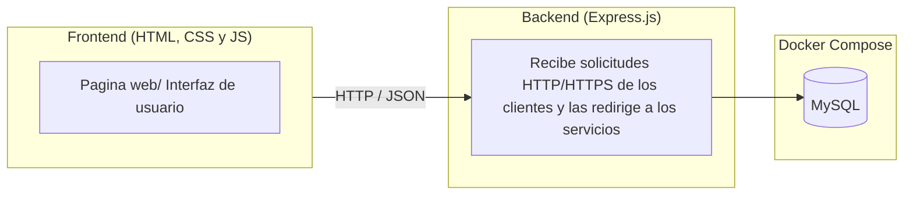
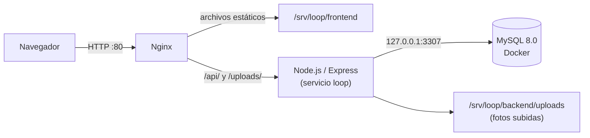

# Proyecto_SED_02-26

# Descripcion: 
La página web desarrollada consiste en una plataforma de comercio electrónico enfocada en la compra y venta de ropa de segunda mano, cuyo principal objetivo es la reducción del desperdicio textil mediante la reutilización de prendas en buen estado que ya no son utilizadas por sus propietarios.

La plataforma permite que los usuarios participen tanto como vendedores y compradores, ofreciendo un espacio digital accesible en el que puedan publicar, consultar y adquirir diferentes prendas de vestir.

Para realizar ventas, los usuarios deben registrarse e iniciar sesión en la plataforma. Posteriormente, pueden acceder a la sección de productos y completar un formulario en el que proporcionan información relevante sobre las prendas que desean ofrecer y una imagen representativa del producto.

Por otra parte, los usuarios interesados en adquirir ropa pueden explorar el catálogo disponible, consultar las características de cada producto y agregarlos a un carrito de compras. Una vez seleccionados los artículos se procede con el proceso de compra donde se genera una factura que detalla los productos adquiridos y el monto total de la operación.


El sistema incluye los siguientes __roles:__
1. *Usuario publico:* accede a la pagina sin necesidad de registrarse o de inciar sesión, puede visualizar de forma general el sitio y consultar información básica.
2. *Vendedor:* tiene acceso a funcionalidades de compra y venta; puede publicar ropa a partir de un formulario donde proporciona especificaciones del producto, agregar al carrito de compras y realizar pedidos.
3. *Admin:* tiene acceso a funcionalidades adminsitrativas que le permite supervisar y gestionar su funcionamiento. Se encarga de administrar usuarios, gestión de productos y control de la inforamción almacenada en el sistema.

# Arquitectura:



1. __Tecnologias:__ 
Express.js, Node.js, Docker, Javascript

2. __Base de datos:__ MySQL

3. __Estructura carpetas:__
```text
proyecto
├── 📁 backend/
│   ├── ⚙️ config/
│   │   └── database.js
│   ├── 🎮 controllers/
│   │   ├── adminController.js
│   │   ├── carritoController.js
│   │   ├── pedidosController.js
│   │   ├── productosController.js
│   │   ├── stockController.js
│   │   └── validacionProducto.js
│   ├──  🗃️  db/
│   │   ├── migracion_roles.sql
│   │   ├── pedidos_factura.sql
│   │   └── tienda_ropa.sql
│   ├── 🛡️ middleware/
│   │   ├── auth.js
│   │   └── upload.js
│   ├── 🛣️ routes/
│   │   ├── admin.js
│   │   ├── carrito.js
│   │   ├── pedidos.js
│   │   ├── productos.js
│   │   └── stocke.js
│   └── 🔧 scripts/
│       └── crear-admin.js
│
├── 🎨 frontend/
│   ├── 🖼️ assets/
│   │   ├── 🔣 icons/
│   │   │   ├── footer/
│   │   │   │   ├── facebook.svg
│   │   │   │   ├── instagram.svg
│   │   │   │   └── pinterest.svg
│   │   │   ├── home/
│   │   │   │   └── add-cart.svg
│   │   │   ├── navigation/
│   │   │   │   ├── cart.svg
│   │   │   │   ├── search.svg
│   │   │   │   └── user.svg
│   │   │   ├── sell-page/
│   │   │   │   └── user.svg
│   │   │   ├── sell-panel/
│   │   │   │   ├── create.svg
│   │   │   │   ├── dashboard.svg
│   │   │   │   ├── edit-profile.svg
│   │   │   │   └── stock.svg
│   │   │   ├── shoppingCart/
│   │   │   │   ├── cart-arrow.svg
│   │   │   │   ├── cart-check.svg
│   │   │   │   ├── cart-plus.svg
│   │   │   │   ├── cart.svg
│   │   │   │   └── trash.svg
│   │   │   └── .gitkeep
│   │   └── 🌄 images/
│   │       ├── banner/
│   │       │   ├── banner1.jpg
│   │       │   ├── banner2.jpg
│   │       │   └── banner3.jpg
│   │       ├── home/
│   │       │   ├── hero1.jpg
│   │       │   └── hero2.jpg
│   │       ├── logo/
│   │       │   ├── logo-loop-horizontal.svg
│   │       │   └── logo-loop.svg
│   │       └── .gitkeep
│   │
│   ├── 💅 css/
│   │   ├── general/
│   │   │   ├── footer.css
│   │   │   └── header.css
│   │   ├── login/
│   │   │   └── style_login.css
│   │   ├── main/
│   │   │   ├── home.css
│   │   │   └── product.css
│   │   ├── sell/
│   │   │   └── vender.css
│   │   ├── seller-styles/
│   │   │   ├── item-register-page.css
│   │   │   ├── panel.css
│   │   │   └── stock.css
│   │   ├── shared/
│   │   │   ├── components.css
│   │   │   └── productos.css
│   │   ├── shoppingCart/
│   │   │   ├── cart.css
│   │   │   └── receipt.css
│   │   └── .gitkeep
│   │
│   ├── ⚡ js/
│   │   ├── admin/
│   │   │   └── panel.js
│   │   ├── data/
│   │   │   └── mockProducts.js
│   │   ├── frontend-common/
│   │   │   └── components.js
│   │   ├── general/
│   │   │   ├── product-utils.js
│   │   │   ├── reuse.js
│   │   │   └── session.js
│   │   ├── login/
│   │   │   ├── script_login.js
│   │   │   └── script_registro.js
│   │   ├── main/
│   │   │   ├── home.js
│   │   │   └── product.js
│   │   ├── product-registration/
│   │   │   └── item-register-page.js
│   │   ├── sell/
│   │   │   └── carousel.js
│   │   ├── seller/
│   │   │   ├── panel.js
│   │   │   └── stock.js
│   │   ├── shared/
│   │   │   └── productos.js
│   │   ├── shoppingCart/
│   │   │   ├── cart.js
│   │   │   ├── cartService.js
│   │   │   └── receipt.js
│   │   └── .gitkeep
│   │
│   ├── 📄 modules/
│   │   ├── admin/
│   │   │   └── panel.html
│   │   ├── components/
│   │   │   ├── footer.html
│   │   │   └── navbar.html
│   │   ├── general/
│   │   │   ├── footer.html
│   │   │   └── header.html
│   │   ├── login/
│   │   │   ├── index_login.html
│   │   │   └── registro.html
│   │   ├── productDetail/
│   │   │   └── product.js
│   │   ├── sell/
│   │   │   └── sell.html
│   │   ├── seller/
│   │   │   ├── item-register-form.html
│   │   │   ├── panel.html
│   │   │   └── stoc.html
│   │   ├── shoppingCart/
│   │   │   ├── cart.html
│   │   │   └── receipt.html
│   │   └── .gitkeep
│   │
│   ├── index.html
│   ├── .gitignore
│   └── README.md
│
├── .env.example
├── .gitattributes
├── .npmrc
├── app.js
├── 🐳 docker-compose.yml
├── package-lock.json
├── package.json
└── server.js
```


# 3. Guía de instalación y despliegue

Esta guía describe cómo se montó el servidor del proyecto, desde la creación de la máquina virtual hasta la aplicación funcionando.

**Resumen del despliegue**

| Componente | Qué se usa | Dónde escucha |
|---|---|---|
| Máquina virtual | VMware, Ubuntu Server 24.04.5 LTS | IP de la red local por DHCP |
| Servidor web | Nginx 1.24: sirve el frontend y hace de proxy de la API | puerto 80 |
| Aplicación | Node.js 26 + Express, servicio `loop` de systemd | puerto 3000 (solo lo usa Nginx) |
| Base de datos | MySQL 8.0 en Docker Compose (contenedor `proyecto_SED`) | puerto 3307 |
| Acceso remoto | SSH con llave y Tailscale | puerto 22 |
| Firewall | ufw | abiertos solo 22 y 80 |



## 1. Crear la máquina virtual

1. Descargar **Ubuntu Server 24.04 LTS** desde https://ubuntu.com/download/server.
2. En **VMware** crear una máquina virtual nueva con:

   | Recurso | Valor usado |
   |---|---|
   | CPU | 2 núcleos |
   | Memoria RAM | 4 GB |
   | Disco | 20 GB (LVM, lo propone el instalador) |
   | Red | Adaptador puente (*bridged*): la máquina toma una IP de la red local por DHCP |

3. Instalar Ubuntu con las opciones por defecto y crear el usuario administrador.
4. Al terminar, actualizar el sistema:

   ```bash
   sudo apt update && sudo apt upgrade -y
   sudo apt install -y curl
   ```

## 2. Acceso remoto con Tailscale

Tailscale crea una red privada entre el servidor y las computadoras del equipo, sin abrir puertos al internet.

```bash
curl -fsSL https://tailscale.com/install.sh | sh
sudo systemctl enable --now tailscaled
sudo tailscale up          # muestra un enlace para iniciar sesión
sudo tailscale ip -4       # IP del servidor dentro de Tailscale (100.x.x.x)
```

Después, desde el panel de Tailscale se comparte la máquina con cada integrante del equipo.

## 3. SSH y usuarios del equipo

Instalar el servidor SSH:

```bash
sudo apt install -y openssh-server
sudo systemctl enable --now ssh
```

Crear un usuario por integrante y darle permisos de administrador (`sudo`):

```bash
sudo useradd -m -s /bin/bash <usuario>
sudo passwd <usuario>
sudo usermod -aG sudo <usuario>
```

Cada integrante genera un par de llaves en su computadora (por ejemplo con Termius o `ssh-keygen -t ed25519`) y pasa **solo la llave pública**, que se guarda en el servidor:

```bash
sudo mkdir -p /home/<usuario>/.ssh
sudo nano /home/<usuario>/.ssh/authorized_keys      # pegar la llave pública
sudo chmod 700 /home/<usuario>/.ssh
sudo chmod 600 /home/<usuario>/.ssh/authorized_keys
sudo chown -R <usuario>:<usuario> /home/<usuario>/.ssh
```

Endurecer SSH en `/etc/ssh/sshd_config.d/00-hardening.conf`:

```text
PermitRootLogin no
PubkeyAuthentication yes
PasswordAuthentication no
AllowUsers <usuario1> <usuario2> <usuario3> <usuario4> <usuario5>
```

- `PermitRootLogin no`: nadie entra directamente como root.
- `PasswordAuthentication no`: solo se entra con llave, no con contraseña.
- `AllowUsers`: solo los usuarios del equipo pueden conectarse.

```bash
sudo sshd -t                     # revisa que la configuración no tenga errores
sudo systemctl restart ssh
sudo sshd -T | grep -Ei 'permitrootlogin|passwordauthentication|allowusers'   # valores efectivos
```

> El archivo empieza con `00-` para que se lea primero: en SSH vale el primer valor que aparece, así que estas reglas ganan sobre cualquier otro archivo de configuración.

## 4. Paquetes base

```bash
sudo apt install -y git nginx ufw
sudo apt install -y curl ca-certificates gpg
```

## 5. Node.js 26 (repositorio de NodeSource)

```bash
sudo install -m 0755 -d /etc/apt/keyrings
curl -fsSL https://deb.nodesource.com/gpgkey/nodesource-repo.gpg.key | sudo gpg --dearmor -o /etc/apt/keyrings/nodesource.gpg
NODE_MAJOR=26
echo "deb [signed-by=/etc/apt/keyrings/nodesource.gpg] https://deb.nodesource.com/node_$NODE_MAJOR.x nodistro main" | sudo tee /etc/apt/sources.list.d/nodesource.list
sudo apt update
sudo apt install -y nodejs
node -v     # v26.x
npm -v
```

## 6. Docker y Docker Compose (repositorio oficial)

```bash
sudo curl -fsSL https://download.docker.com/linux/ubuntu/gpg -o /etc/apt/keyrings/docker.asc
sudo chmod a+r /etc/apt/keyrings/docker.asc
sudo tee /etc/apt/sources.list.d/docker.sources <<EOF
Types: deb
URIs: https://download.docker.com/linux/ubuntu
Suites: $(. /etc/os-release && echo "${UBUNTU_CODENAME:-$VERSION_CODENAME}")
Components: stable
Signed-By: /etc/apt/keyrings/docker.asc
EOF
sudo apt update
sudo apt install -y docker-ce docker-ce-cli containerd.io docker-buildx-plugin docker-compose-plugin
sudo docker run --rm hello-world
sudo docker compose version
```

## 7. Descargar el proyecto

El proyecto vive en `/srv/loop` y se usa la rama `develop`:

```bash
sudo mkdir -p /srv/loop && sudo chown $USER:$USER /srv/loop
git clone https://github.com/W4samGG7/Proyecto_SED_02-26.git /srv/loop
cd /srv/loop
git checkout develop
```

Para que todo el equipo pueda actualizar el proyecto, se crea el grupo `gitloop` y se le dan permisos sobre la carpeta (el bit `setgid` hace que los archivos nuevos hereden el grupo):

```bash
sudo groupadd -f gitloop
sudo usermod -aG gitloop <usuario>          # repetir para cada integrante
sudo chgrp -R gitloop /srv/loop
sudo chmod -R g+rwX /srv/loop
sudo find /srv/loop -type d -exec chmod g+s {} +
git config --global --add safe.directory /srv/loop
```

## 8. Variables de entorno

Todo el backend se configura con `backend/.env`, que **no se sube al repositorio** (está en `.gitignore`).

```bash
cd /srv/loop/backend
cp .env.example .env
nano .env
```

| Variable | Para qué sirve |
|---|---|
| `DB_HOST` | Dónde está MySQL (`127.0.0.1`) |
| `DB_PORT` | Puerto de MySQL en el servidor (`3307`) |
| `DB_NAME` | Nombre de la base de datos (`tienda_ropa`) |
| `DB_USER` | Usuario de la aplicación, sin permisos de root |
| `DB_PASSWORD` | Contraseña de ese usuario |
| `DB_ROOT_PASSWORD` | Contraseña de root de MySQL |
| `SESSION_SECRET` | Clave con la que se firma la cookie de sesión |
| `PORT` | Puerto interno de la aplicación (`3000`) |

Las contraseñas y el secreto de sesión se generan al azar:

```bash
node -e "console.log(require('crypto').randomBytes(32).toString('hex'))"
```

## 9. Base de datos (MySQL en Docker)

`backend/docker-compose.yml` crea el contenedor **`proyecto_SED`** con MySQL 8.0. Toma los usuarios y contraseñas del `.env`, guarda los datos en el volumen `mysql_data` y, **la primera vez**, ejecuta `db/tienda_ropa.sql`, que crea las tablas y los productos de ejemplo.

```bash
cd /srv/loop/backend
sudo docker compose up -d
sudo docker compose ps
sudo docker compose logs mysql        # esperar "ready for connections"
```

Comprobar que se crearon las tablas (la contraseña la toma el contenedor de sus propias variables, así no queda escrita en el historial):

```bash
sudo docker compose exec -T mysql sh -c 'mysql -u"$MYSQL_USER" -p"$MYSQL_PASSWORD" "$MYSQL_DATABASE"' <<< "SHOW TABLES;"
```

Eliminar el usuario `root` remoto que crea la imagen de MySQL (root solo puede entrar desde dentro del contenedor):

```bash
echo "DROP USER 'root'@'%';" | sudo docker compose exec -T mysql sh -c 'mysql -uroot -p"$MYSQL_ROOT_PASSWORD"'
```

### Bases de datos creadas con una versión anterior

`tienda_ropa.sql` ya trae todas las tablas y columnas, pero **solo se ejecuta cuando la base no existe** (y si se corre a mano, borra todos los datos). Para actualizar una base que ya tiene datos se aplica cada migración **una sola vez**:

| Script | Qué agrega |
|---|---|
| `db/migracion_roles.sql` | Columnas `rol` y `activo` en `usuarios` |
| `db/pedidos_factura.sql` | Columnas `marca` y `talla` en `detalle_pedidos` |
| `db/imagenes_locales.sql` | Fotos de ejemplo guardadas en el proyecto en lugar de enlaces externos |

```bash
sudo docker compose exec -T mysql sh -c 'mysql -uroot -p"$MYSQL_ROOT_PASSWORD" tienda_ropa' < db/migracion_roles.sql
```

## 10. Dependencias y usuario de la aplicación

Instalar solo las dependencias de producción:

```bash
cd /srv/loop/backend
npm ci --omit=dev
```

> El `.npmrc` del proyecto bloquea los scripts de instalación de los paquetes y los paquetes publicados hace menos de 7 días, como protección contra paquetes maliciosos.

La aplicación no corre como root ni como un integrante: se crea un **usuario de sistema `loop`**, sin contraseña ni consola, que solo puede escribir en la carpeta de fotos:

```bash
sudo useradd --system --home /srv/loop --shell /usr/sbin/nologin loop
mkdir -p uploads && sudo chown loop:loop uploads
sudo chown root:loop .env && sudo chmod 640 .env      # solo root escribe, loop solo lee
```

## 11. Servicio de systemd

`/etc/systemd/system/loop.service` hace que la aplicación arranque sola al encender el servidor y se reinicie si se cae. Además la **aísla del resto del sistema**:

```ini
[Unit]
Description=LOOP backend (Node.js)
After=network.target docker.service
Wants=docker.service

[Service]
User=loop
WorkingDirectory=/srv/loop/backend
ExecStart=/usr/bin/node server.js
Restart=on-failure
RestartSec=5
NoNewPrivileges=true
ProtectSystem=strict
ReadWritePaths=/srv/loop/backend/uploads
ProtectHome=true
PrivateTmp=true
PrivateDevices=true
ProtectKernelTunables=true
ProtectKernelModules=true
ProtectControlGroups=true
RestrictAddressFamilies=AF_INET AF_INET6 AF_UNIX
CapabilityBoundingSet=
LockPersonality=true

[Install]
WantedBy=multi-user.target
```

| Opción | Qué hace |
|---|---|
| `User=loop` | Corre con el usuario sin privilegios |
| `NoNewPrivileges`, `CapabilityBoundingSet=` | No puede conseguir más permisos |
| `ProtectSystem=strict` + `ReadWritePaths` | Todo el disco es de solo lectura excepto la carpeta `uploads` |
| `ProtectHome`, `PrivateTmp`, `PrivateDevices` | No ve las carpetas de los usuarios, ni `/tmp` compartido, ni dispositivos |
| `ProtectKernel*`, `ProtectControlGroups` | No puede modificar el kernel ni los grupos de control |
| `RestrictAddressFamilies` | Solo puede usar red IPv4, IPv6 y sockets locales |

```bash
sudo systemctl daemon-reload
sudo systemctl enable --now loop
sudo systemctl status loop
sudo journalctl -u loop -n 30 --no-pager      # registros de la aplicación
sudo systemd-analyze security loop            # puntaje de aislamiento del servicio
```

## 12. Nginx (servidor web)

Nginx sirve los archivos del frontend directamente desde `/srv/loop/frontend` y solo pasa a Node.js las peticiones de la API y las fotos subidas.

`/etc/nginx/sites-available/loop`:

```nginx
server {
    listen 80 default_server;
    server_name _;
    root /srv/loop/frontend;
    index index.html;

    # Las fotos de productos pueden pesar hasta 2 MB
    client_max_body_size 3m;

    location / {
        try_files $uri $uri/ =404;
    }

    location /api/ {
        proxy_pass http://127.0.0.1:3000;
        proxy_set_header Host $host;
        proxy_set_header X-Real-IP $remote_addr;
        proxy_set_header X-Forwarded-For $proxy_add_x_forwarded_for;
        proxy_set_header X-Forwarded-Proto $scheme;
    }

    location /uploads/ {
        proxy_pass http://127.0.0.1:3000;
    }

    # Cabeceras de seguridad
    add_header X-Content-Type-Options "nosniff" always;
    add_header X-Frame-Options "DENY" always;
    add_header Referrer-Policy "strict-origin-when-cross-origin" always;
    add_header Permissions-Policy "camera=(), microphone=(), geolocation=()" always;

    # Bloquear archivos ocultos (.env, .git, etc.)
    location ~ /\. {
        deny all;
    }
}
```

| Cabecera | Para qué sirve |
|---|---|
| `X-Content-Type-Options: nosniff` | El navegador no adivina el tipo de archivo (evita ejecutar un archivo como script) |
| `X-Frame-Options: DENY` | La página no se puede meter dentro de otra (*clickjacking*) |
| `Referrer-Policy` | No se envía la dirección completa a otros sitios |
| `Permissions-Policy` | Bloquea cámara, micrófono y ubicación |

En `/etc/nginx/nginx.conf` se agrega `server_tokens off;` (dentro de `http { }`) para que Nginx no muestre su versión.

Activar el sitio y quitar el de ejemplo:

```bash
sudo ln -s /etc/nginx/sites-available/loop /etc/nginx/sites-enabled/
sudo rm /etc/nginx/sites-enabled/default
sudo nginx -t && sudo systemctl reload nginx
curl -I http://localhost/.env        # debe responder 403
```

## 13. Firewall (ufw)

Solo quedan abiertos SSH y HTTP. Todo lo demás que entra se bloquea.

```bash
sudo ufw allow OpenSSH
sudo ufw allow 80/tcp
sudo ufw enable
sudo ufw status verbose
```

> **Ojo con Docker:** los puertos que publica Docker no pasan por las reglas de `ufw`. Por eso en `docker-compose.yml` MySQL se publica solo en `127.0.0.1:3307`; si se publica en `0.0.0.0`, la base queda accesible desde la red aunque el firewall la bloquee.

## 14. Crear las cuentas de prueba y el administrador

```bash
cd /srv/loop/backend
npm run usuarios-prueba
```

Crea una cuenta por rol (ver **4. Usuarios y credenciales de prueba**).

Para convertir en administrador a una cuenta registrada desde la página:

```bash
npm run crear-admin -- correo@ejemplo.com
```

## 15. Verificar que todo funciona

```bash
sudo systemctl status loop nginx docker
sudo docker compose ps
sudo ss -tlnp | grep -E ':(22|80|3000|3307)\b'
curl -I http://localhost/                  # 200, servidor nginx sin versión
curl -s http://localhost/api/productos | head -c 200
```

Desde el navegador, entrar a `http://<IP-del-servidor>/` (la IP de la red local o la de Tailscale) y:

1. Ver el catálogo como usuario público.
2. Iniciar sesión con las cuentas de prueba de cada rol.
3. Como vendedor, publicar un artículo con foto y revisarlo en **Gestión de stock**.
4. Como admin, revisar el **Panel de administración**.

## 16. Actualizar el servidor con cambios nuevos

Los cambios se hacen en el repositorio (nunca editando archivos directamente en el servidor) y después:

```bash
cd /srv/loop
git pull
cd backend
npm ci --omit=dev
sudo systemctl restart loop
sudo nginx -t && sudo systemctl reload nginx
```

Si el cambio trae un script nuevo en `backend/db/`, aplicarlo como se explica en el paso 9.

## Desarrollo local (sin máquina virtual)

En la computadora de cada integrante se usan los mismos pasos 7 a 10 y 14: clonar el repositorio, crear `backend/.env`, `docker compose up -d`, `npm ci`, `npm run usuarios-prueba` y `npm start`. La aplicación queda en http://localhost:3000 (sin Nginx, Express sirve también el frontend).

# 4. Usuarios y credenciales de prueba

Estas cuentas se crean con `npm run usuarios-prueba` (paso 14), tanto en el servidor del proyecto como en la computadora de cada integrante. **Son solo para pruebas y para la revisión del proyecto**: en una tienda en producción se eliminarían.

| Rol | Correo | Contraseña | Qué puede hacer |
|---|---|---|---|
| Usuario público | *(no necesita cuenta)* | — | Ver el catálogo y el detalle de los productos |
| Usuario (vendedor) | `vendedor@loop.test` | `VendedorLoop2026` | Publicar artículos, administrar su stock, comprar |
| Usuario (comprador) | `comprador@loop.test` | `CompradorLoop2026` | Agregar al carrito, comprar y ver su factura |
| Administrador | `admin@loop.test` | `AdminLoop2026` | Gestionar usuarios (rol, activar/desactivar, eliminar) y los productos de todos los vendedores |

- **Vendedor y comprador** tienen el mismo rol en el sistema (`usuario`): cualquier usuario registrado puede vender y comprar. Se crean dos cuentas para poder probar una compra entre personas distintas.
- **El vendedor de prueba** recibe los productos de ejemplo, así que ya tiene productos en **Gestión de stock**.
- **El administrador** no puede comprar ni vender: al iniciar sesión entra directo al **Panel de administración**.
- **Las contraseñas** se guardan cifradas con bcrypt, igual que las de cualquier usuario registrado.
- **Para crear otro administrador** se registra la cuenta en la página y se ejecuta `npm run crear-admin -- correo@ejemplo.com`.
- **Las cuentas reales** del proyecto (por ejemplo, el administrador de la tienda) no se documentan aquí: sus contraseñas no deben quedar en un repositorio público.

Para comprobar en el servidor que las cuentas de prueba existen:

```bash
cd /srv/loop/backend
echo "SELECT correo, rol, activo FROM usuarios WHERE correo LIKE '%@loop.test';" | sudo docker compose exec -T mysql sh -c 'mysql -u"$MYSQL_USER" -p"$MYSQL_PASSWORD" "$MYSQL_DATABASE"'
```

