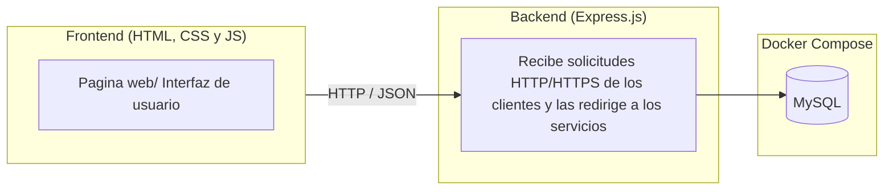
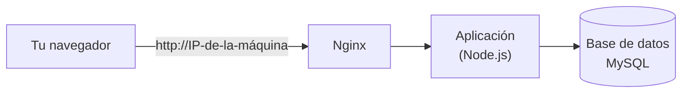
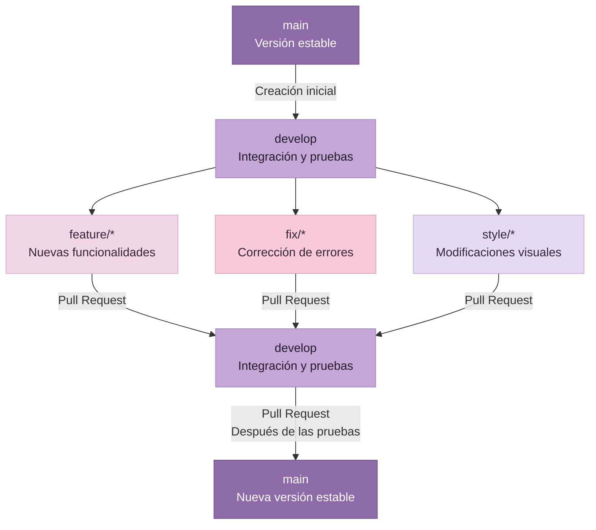

# Proyecto_SED_02-26

# 1. Descripcion: 
La página web desarrollada consiste en una plataforma de comercio electrónico enfocada en la compra y venta de ropa de segunda mano, cuyo principal objetivo es la reducción del desperdicio textil mediante la reutilización de prendas en buen estado que ya no son utilizadas por sus propietarios.

La plataforma permite que los usuarios participen tanto como vendedores y compradores, ofreciendo un espacio digital accesible en el que puedan publicar, consultar y adquirir diferentes prendas de vestir.

Para realizar ventas, los usuarios deben registrarse e iniciar sesión en la plataforma. Posteriormente, pueden acceder a la sección de productos y completar un formulario en el que proporcionan información relevante sobre las prendas que desean ofrecer y una imagen representativa del producto.

Por otra parte, los usuarios interesados en adquirir ropa pueden explorar el catálogo disponible, consultar las características de cada producto y agregarlos a un carrito de compras. Una vez seleccionados los artículos se procede con el proceso de compra donde se genera una factura que detalla los productos adquiridos y el monto total de la operación.


El sistema incluye los siguientes __roles:__
1. *Usuario publico:* accede a la pagina sin necesidad de registrarse o de inciar sesión, puede visualizar de forma general el sitio y consultar información básica.
2. *Vendedor:* tiene acceso a funcionalidades de compra y venta; puede publicar ropa a partir de un formulario donde proporciona especificaciones del producto, agregar al carrito de compras y realizar pedidos.
3. *Admin:* tiene acceso a funcionalidades adminsitrativas que le permite supervisar y gestionar su funcionamiento. Se encarga de administrar usuarios, gestión de productos y control de la inforamción almacenada en el sistema.

# 2. Arquitectura:



2.1 __Tecnologias:__ 
Express.js, Node.js, Docker, Javascript

2.2 __Base de datos:__ MySQL

2.3 __Estructura carpetas:__
```text
proyecto
├── 📁 backend/
│   ├── ⚙️ config/
│   │   └── database.js
│   ├── 🎮 controllers/
│   │   ├── adminController.js
│   │   ├── carritoController.js
│   │   ├── pedidosController.js
│   │   ├── productosController.js
│   │   ├── stockController.js
│   │   └── validacionProducto.js
│   ├──  🗃️  db/
│   │   ├── migracion_roles.sql
│   │   ├── pedidos_factura.sql
│   │   └── tienda_ropa.sql
│   ├── 🛡️ middleware/
│   │   ├── auth.js
│   │   └── upload.js
│   ├── 🛣️ routes/
│   │   ├── admin.js
│   │   ├── carrito.js
│   │   ├── pedidos.js
│   │   ├── productos.js
│   │   └── stocke.js
│   └── 🔧 scripts/
│       └── crear-admin.js
│
├── 🎨 frontend/
│   ├── 🖼️ assets/
│   │   ├── 🔣 icons/
│   │   │   ├── footer/
│   │   │   │   ├── facebook.svg
│   │   │   │   ├── instagram.svg
│   │   │   │   └── pinterest.svg
│   │   │   ├── home/
│   │   │   │   └── add-cart.svg
│   │   │   ├── navigation/
│   │   │   │   ├── cart.svg
│   │   │   │   ├── search.svg
│   │   │   │   └── user.svg
│   │   │   ├── sell-page/
│   │   │   │   └── user.svg
│   │   │   ├── sell-panel/
│   │   │   │   ├── create.svg
│   │   │   │   ├── dashboard.svg
│   │   │   │   ├── edit-profile.svg
│   │   │   │   └── stock.svg
│   │   │   ├── shoppingCart/
│   │   │   │   ├── cart-arrow.svg
│   │   │   │   ├── cart-check.svg
│   │   │   │   ├── cart-plus.svg
│   │   │   │   ├── cart.svg
│   │   │   │   └── trash.svg
│   │   │   └── .gitkeep
│   │   └── 🌄 images/
│   │       ├── banner/
│   │       │   ├── banner1.jpg
│   │       │   ├── banner2.jpg
│   │       │   └── banner3.jpg
│   │       ├── home/
│   │       │   ├── hero1.jpg
│   │       │   └── hero2.jpg
│   │       ├── logo/
│   │       │   ├── logo-loop-horizontal.svg
│   │       │   └── logo-loop.svg
│   │       └── .gitkeep
│   │
│   ├── 💅 css/
│   │   ├── general/
│   │   │   ├── footer.css
│   │   │   └── header.css
│   │   ├── login/
│   │   │   └── style_login.css
│   │   ├── main/
│   │   │   ├── home.css
│   │   │   └── product.css
│   │   ├── sell/
│   │   │   └── vender.css
│   │   ├── seller-styles/
│   │   │   ├── item-register-page.css
│   │   │   ├── panel.css
│   │   │   └── stock.css
│   │   ├── shared/
│   │   │   ├── components.css
│   │   │   └── productos.css
│   │   ├── shoppingCart/
│   │   │   ├── cart.css
│   │   │   └── receipt.css
│   │   └── .gitkeep
│   │
│   ├── ⚡ js/
│   │   ├── admin/
│   │   │   └── panel.js
│   │   ├── data/
│   │   │   └── mockProducts.js
│   │   ├── frontend-common/
│   │   │   └── components.js
│   │   ├── general/
│   │   │   ├── product-utils.js
│   │   │   ├── reuse.js
│   │   │   └── session.js
│   │   ├── login/
│   │   │   ├── script_login.js
│   │   │   └── script_registro.js
│   │   ├── main/
│   │   │   ├── home.js
│   │   │   └── product.js
│   │   ├── product-registration/
│   │   │   └── item-register-page.js
│   │   ├── sell/
│   │   │   └── carousel.js
│   │   ├── seller/
│   │   │   ├── panel.js
│   │   │   └── stock.js
│   │   ├── shared/
│   │   │   └── productos.js
│   │   ├── shoppingCart/
│   │   │   ├── cart.js
│   │   │   ├── cartService.js
│   │   │   └── receipt.js
│   │   └── .gitkeep
│   │
│   ├── 📄 modules/
│   │   ├── admin/
│   │   │   └── panel.html
│   │   ├── components/
│   │   │   ├── footer.html
│   │   │   └── navbar.html
│   │   ├── general/
│   │   │   ├── footer.html
│   │   │   └── header.html
│   │   ├── login/
│   │   │   ├── index_login.html
│   │   │   └── registro.html
│   │   ├── productDetail/
│   │   │   └── product.js
│   │   ├── sell/
│   │   │   └── sell.html
│   │   ├── seller/
│   │   │   ├── item-register-form.html
│   │   │   ├── panel.html
│   │   │   └── stoc.html
│   │   ├── shoppingCart/
│   │   │   ├── cart.html
│   │   │   └── receipt.html
│   │   └── .gitkeep
│   │
│   ├── index.html
│   ├── .gitignore
│   └── README.md
│
├── .env.example
├── .gitattributes
├── .npmrc
├── app.js
├── 🐳 docker-compose.yml
├── package-lock.json
├── package.json
└── server.js
```


# 3. Guía de instalación y despliegue

Esta guía explica cómo poner a funcionar la tienda **a partir de la máquina virtual del proyecto**, que ya trae todo instalado y configurado. No hace falta instalar nada dentro de ella: solo importarla, encenderla y comprobar que funciona.

## 3.1 Qué trae la máquina virtual

| Componente | Qué es | Para qué sirve |
|---|---|---|
| Ubuntu Server 24.04 LTS | Sistema operativo | Es la "computadora" donde vive la tienda |
| Nginx | Servidor web | Recibe las visitas del navegador y muestra la página |
| Node.js 26 + Express (servicio `loop`) | Aplicación | Maneja el inicio de sesión, los productos, el carrito y los pedidos |
| MySQL 8.0 en Docker (contenedor `proyecto_SED`) | Base de datos | Guarda los usuarios, productos y pedidos |
| ufw | Firewall | Solo deja entrar por la página web (puerto 80) y SSH (puerto 22) |

Todo arranca solo al encender la máquina.



## 3.2 Qué necesitás

| Requisito | Mínimo |
|---|---|
| Memoria RAM de tu computadora | 8 GB (la máquina virtual usa 4 GB) |
| Espacio libre en disco | 25 GB |
| Programa de virtualización | **VMware Workstation Pro** (gratuito) |
| Los archivos de la máquina virtual | Una carpeta con `Proyecto-SED.ovf` y `Proyecto-SED-disk1.vmdk` (la entrega el equipo) |

> También funciona con **VirtualBox**; los pasos son parecidos y están indicados donde cambian.

## Paso 1: Instalar VMware Workstation Pro

1. Descargar **VMware Workstation Pro** desde la página de Broadcom (es gratuito para uso personal; pide crear una cuenta).
2. Instalarlo con las opciones por defecto y reiniciar la computadora si lo pide.

## Paso 2: Importar la máquina virtual

1. Abrir VMware Workstation.
2. Ir a **File → Open…** (Archivo → Abrir) y elegir el archivo **`Proyecto-SED.ovf`**.
   El `.ovf` solo describe la máquina; el disco es el `.vmdk`, así que **los dos tienen que estar en la misma carpeta**. Si la carpeta viene en un `.zip`, primero descomprimirla (clic derecho → **Extraer todo**).
3. Escribir un nombre (por ejemplo `Proyecto SED`) y elegir la carpeta donde se va a guardar.
4. Hacer clic en **Import** y esperar a que termine (puede tardar unos minutos).
5. Si aparece un aviso de que el archivo no cumple con la especificación OVF, hacer clic en **Retry** (Reintentar): es normal y la importación continúa.

> **Con VirtualBox:** **Archivo → Importar servicio virtualizado**, elegir el `.ovf`, dejar los valores por defecto y hacer clic en **Importar**.

## Paso 3: Revisar la red

La máquina ya viene con el adaptador de red en **Bridged (puente), automático**: se conecta a la misma red que tu computadora (wifi o cable) y toma una IP de esa red, como si fuera otra computadora más. Solo hay que comprobarlo:

1. Seleccionar la máquina y abrir **Edit virtual machine settings** (Configuración).
2. En **Network Adapter** (Adaptador de red) tiene que estar marcado **Bridged: Connected directly to the physical network**.
3. Guardar con **OK**.

> En algunas redes (por ejemplo, el wifi de una universidad o de un lugar público) el modo Bridged no recibe IP. En ese caso, cambiarlo a **NAT**: la tienda solo se va a poder abrir desde tu computadora, pero funciona igual.

> **Con VirtualBox:** en **Configuración → Red** revisar que diga **Adaptador puente** (*Bridged*) y elegir la tarjeta de red que usa tu computadora (wifi o cable).

## Paso 4: Encender la máquina e iniciar sesión

1. Hacer clic en **Power on this virtual machine** (Encender).
2. Esperar a que aparezca el texto `login:` en la pantalla negra (puede tardar uno o dos minutos).
3. Escribir el **usuario** y la **contraseña** de la máquina, que el equipo entrega junto con el archivo de la máquina virtual. Al escribir la contraseña no se ven los caracteres: es normal.

> Para escribir dentro de la máquina hay que hacer clic sobre ella. Para volver a tu computadora se presiona **Ctrl + Alt**.

## Paso 5: Averiguar la dirección IP de la máquina

La IP es la "dirección" con la que tu navegador encuentra la tienda. Dentro de la máquina, escribir:

```bash
hostname -I
```

Aparecen varias direcciones separadas por espacios. La que sirve es la de la red de tu computadora, que normalmente empieza con **`192.168.`** o **`10.`**, por ejemplo `192.168.0.26`. Anotarla.

> No sirven las que empiezan con `172.` (son internas de Docker) ni con `100.` (son de Tailscale, la red privada del equipo).

## Paso 6: Comprobar que todo está funcionando

Escribir este comando dentro de la máquina (pide la contraseña):

```bash
sudo systemctl status loop nginx docker --no-pager
```

Cada uno de los tres servicios tiene que decir **`active (running)`** en verde:

| Servicio | Qué es |
|---|---|
| `loop` | La aplicación de la tienda |
| `nginx` | El servidor web |
| `docker` | El programa que corre la base de datos |

Después, revisar la base de datos:

```bash
sudo docker ps
```

Tiene que aparecer **`proyecto_SED`** con el estado **`Up`**.

Por último, probar la tienda desde la misma máquina:

```bash
curl -I http://localhost/
```

La primera línea tiene que decir **`HTTP/1.1 200 OK`**.

## Paso 7: Abrir la tienda en el navegador

1. En tu computadora (fuera de la máquina virtual), abrir el navegador.
2. Escribir en la barra de direcciones `http://` y la IP del paso 5, por ejemplo **`http://192.168.0.26`**.
3. Tiene que aparecer la página principal de **Loop** con los productos.

## Paso 8: Probar cada rol

Con las cuentas de la sección **4. Usuarios y credenciales de prueba**:

| Rol | Qué probar | Qué tiene que pasar |
|---|---|---|
| Usuario público | Entrar sin iniciar sesión y abrir un producto | Se ve el catálogo y el detalle del producto |
| Vendedor | Iniciar sesión → **Vender** → **Publicar artículo** con una foto | El artículo aparece en **Gestión de stock** |
| Comprador | Iniciar sesión → agregar productos al carrito → comprar | Se muestra la factura del pedido |
| Administrador | Iniciar sesión | Entra directo al **Panel de administración** y ve a todos los usuarios |

Si todo esto funciona, la instalación está completa.

## Si algo no funciona

| Problema | Qué hacer |
|---|---|
| El navegador dice "no se puede acceder al sitio" | Revisar que la máquina esté encendida y que la IP sea la del paso 5. Si cambiaste la red, apagar y encender la máquina y volver a buscar la IP. |
| `hostname -I` no muestra ninguna IP que empiece con `192.168.` o `10.` | La red no le dio IP en modo Bridged. Apagar la máquina, cambiar el adaptador a **NAT** (paso 3), encenderla y volver al paso 5. |
| Algún servicio no dice `active (running)` | Reiniciarlo: `sudo systemctl restart loop` (o `nginx` o `docker`) y volver a revisar con el comando del paso 6. |
| `proyecto_SED` no aparece o no dice `Up` | Encender la base de datos: `sudo docker start proyecto_SED` y después `sudo systemctl restart loop`. |
| La página abre pero no muestra productos o da error | Esperar un minuto (la base de datos tarda en arrancar) y recargar. Si sigue igual: `sudo systemctl restart loop`. |
| Las cuentas de la sección 4 no inician sesión | Revisar que el correo y la contraseña estén bien escritos (la contraseña distingue mayúsculas). Si sigue sin funcionar, crear las cuentas de prueba adicionales con `cd /srv/loop/backend && npm run usuarios-prueba` y usar esas. |
| Ver los mensajes de error de la aplicación | `sudo journalctl -u loop -n 30 --no-pager` |

## Apagar la máquina

Para no dañar la base de datos, apagarla desde adentro en lugar de cerrar la ventana:

```bash
sudo shutdown now
```

# 4. Usuarios y credenciales de prueba

## 4.1 Acceso a la máquina virtual

El usuario y la contraseña para iniciar sesión dentro de la máquina (paso 4 de la guía) **no se publican en este repositorio**: el equipo los entrega por separado, junto con el archivo de la máquina virtual.

Esa cuenta tiene permisos de administrador (`sudo`), que se necesitan para los comandos de comprobación del paso 6.

## 4.2 Cuentas de la tienda

Estas cuentas ya vienen creadas en la máquina virtual y sirven para probar cada rol desde el navegador (paso 8 de la guía). **Son solo para pruebas y para la revisión del proyecto**: en una tienda en producción se eliminarían o se les cambiaría la contraseña.

| Rol | Correo | Contraseña | Qué puede hacer |
|---|---|---|---|
| Usuario público | *(no necesita cuenta)* | — | Ver el catálogo y el detalle de los productos |
| Usuario | `m.cruz@gmail.com` | `mariaGato15` | Comprar y vender: publicar artículos, administrar su stock, usar el carrito y ver sus facturas |
| Usuario | `pblmrtnz@gmail.com` | `contra12345` | Comprar y vender |
| Usuario | `C9LC@gmail.com` | `contra98765` | Comprar y vender |
| Administrador | `loop.web@gmail.com` | `loop0965` | Gestionar usuarios (rol, activar/desactivar, eliminar) y los productos de todos los vendedores |
| Administrador (**vulnerable**) | `admin@gmail.com` | `admin` | Lo mismo que el administrador. Su contraseña débil es una **vulnerabilidad implementada a propósito** (ver punto 5) |

- **Usuario** es el mismo rol para comprar y vender: cualquier usuario registrado puede hacer las dos cosas. Hay varias cuentas para poder probar una compra entre personas distintas.
- **El administrador** no puede comprar ni vender: al iniciar sesión entra directo al **Panel de administración**.
- **`admin@gmail.com` / `admin`** existe a propósito para demostrar el riesgo de las credenciales débiles o por defecto: es fácil de adivinar y da acceso total al panel de administración. Se explica en el punto **5. Vulnerabilidades implementadas**. En una tienda real esta cuenta no existiría.
- **Las contraseñas** se guardan cifradas con bcrypt, igual que las de cualquier usuario registrado.
- **Para crear otro administrador** se registra la cuenta en la página y se ejecuta `npm run crear-admin -- correo@ejemplo.com`.

### 4.3 Cuentas de prueba adicionales (opcional)

El comando `npm run usuarios-prueba` (dentro de la máquina, en `/srv/loop/backend`) crea además estas cuentas. El script no duplica cuentas, así que se puede correr varias veces:

| Rol | Correo | Contraseña |
|---|---|---|
| Usuario (vendedor, con los productos de ejemplo) | `vendedor@loop.test` | `VendedorLoop2026` |
| Usuario (comprador) | `comprador@loop.test` | `CompradorLoop2026` |
| Administrador | `admin@loop.test` | `AdminLoop2026` |

Para ver qué cuentas existen en la base de datos (dentro de la máquina):

```bash
cd /srv/loop/backend
echo "SELECT correo, rol, activo FROM usuarios ORDER BY rol, correo;" | sudo docker compose exec -T mysql sh -c 'mysql -u"$MYSQL_USER" -p"$MYSQL_PASSWORD" "$MYSQL_DATABASE"'
```

# 5. Vulnerabilidades implementadas:

Loop incorpora dos vulnerabilidades de seguridad intencionales, pensadas para ser identificadas y explotadas.

## 5.1. Credenciales de administrador débiles y predecibles (página web)

A nivel de aplicación, se creó un usuario con rol de administrador cuyas credenciales son simples:
- **Correo:** `admin@gmail.com`
- **Contraseña:** `admin`

Este usuario cuenta con permisos administrativos dentro de la plataforma (gestión de usuarios y productos), por lo que representa un punto de entrada directo mediante fuerza bruta, ya que tanto el correo como la contraseña siguen patrones comunes y fácilmente predecibles.

Esta vulnerabilidad es agravada por la ausencia de un límite de intentos de inicio de sesión. El endpoint `/api/login` no implementa ninguna limitación de tasa (*rate limiting*), bloqueo temporal de cuenta ni verificación adicional tras varios intentos fallidos, permitiendo enviar solicitudes de inicio de sesión de forma repetida y sin restricciones:
```js
// INICIO DE SESIÓN
app.post("/api/login", async (req, res) => {

    try {

        const { email, password } = req.body;

        if (!email || !password) {
            return res.status(400).json({
                message: "Ingresa tu correo y contraseña."
            });
        }

        const correo = email.trim().toLowerCase();

        // Buscar usuario por correo
        const [usuarios] = await pool.execute(
            "SELECT * FROM usuarios WHERE correo = ?",
            [correo]
        );

        if (usuarios.length === 0) {
            return res.status(401).json({
                message: "El correo o la contraseña son incorrectos."
            });
        }

        const usuario = usuarios[0];

        // Comparar contraseña con el hash almacenado
        const passwordCorrecta = await bcrypt.compare(
            password,
            usuario.contrasena_hash
        );

        if (!passwordCorrecta) {
            return res.status(401).json({
                message: "El correo o la contraseña son incorrectos."
            });
        }

        // ...resto del login (verificación de cuenta activa, creación de sesión, etc.)

    } catch (error) {
        console.error("Error en login:", error);
        return res.status(500).json({
            message: "Error interno al iniciar sesión."
        });
    }

});
```

Puede observarse que no existe ningún middleware ni lógica adicional que limite la cantidad de intentos por usuario o por dirección IP, esto permite automatizar el envío de credenciales al endpoint hasta dar con la combinación correcta.

**Pasos para explotarla:**

## Paso 1.
Ingresa a la página web usando la IP de la máquina virtual.

## Paso 2. 
Haz clic en el icono de cuenta que se encuentra en el navbar.

## Paso 3. 
Si no se conocen las credenciales, es posible intentar un ataque de fuerza bruta contra el inicio de sesión, ya que no se implementa ningún límite de intentos ni bloqueo temporal. Las credenciales del administrador vulnerable son: **correo:** `admin@gmail.com` y **contraseña:** `admin`.

## Paso 4. 
Si obtienes un inicio de sesión exitoso serás redirigido al panel de administrador, en el cual puedes gestionar tanto usuarios como productos.

## 5.2 Puerto SSH (22) expuesto con usuario y contraseña débiles

A nivel de servidor, el puerto **22 (SSH)** se dejó abierto y accesible desde la misma red, protegido por un usuario cuyas credenciales también son intencionamiente débiles:
- **Usuario:** `admin`
- **Contraseña:** `admin`

Algo importante de recalcar, es que los intentos de inicio de sesión en SSH están limitados a 6 en una misma sesión, con un tiempo límite de 120 segundos y un máximo de 10 intentos simultáneos.

```bash
logingracetime 120
maxauthtries 6
maxsessions 10
permitrootlogin no
passwordauthetication yes
```

Este usuario cuenta con permisos completos sobre el servidor. Esto permite que, una vez dentro de él, el atacante pueda:

1. Acceder al contenedor de Docker donde corre la base de datos MySQL.

2. Consultar las tablas de la base de datos directamente.

3. Consultar la tabla `usuarios` y obtener el correo del administrador vulnerable de la aplicación, lo que constituye una **ruta alterna** para comprometer la cuenta de administrador en caso de que la vulnerabilidad 5.1 no pudiera explotarse por fuerza bruta directa en el formulario de login.

De esta forma, ambas vulnerabilidades están conectadas: si no se logra acceder como administrador desde la página web, es posible llegar al mismo resultado comprometiendo primero el servidor.

**Pasos para explotarla:**

## Paso 1:
Abrir Termius y crear un nuevo host usando la dirección IP de la máquina virtual, colocar el puerto 22 de SSH, si no se conocen las credenciales vulnerables es posible intentar un ataque de fuerza bruta, teniendo en cuenta que se debe reiniciar la sesión del host al agotar los intentos de inicio de sesión. Las credenciales del administrador vulnerable son: **Usuario:** `admin` y **Contraseña:** `admin`. Posteriormente, se da click en conectar y esperar que se establezca la conexión con la máquina virtual.

## Paso 2:
Desplazarse a la carpeta de backend de loop dentro del servidor.

```bash
cd /srv

ls

cd /srv/loop

ls

cd /srv/loop/backend
```
o directamente

```bash
cd /srv/loop/backend
```

## Paso 3:
Verificar que dentro de backend se encuentra el contenedor de docker, el cual contiene de la base de datos.

```bash
ls -la /srv/loop/backend
```

## Paso 4: 
Obtener el sistema de gestión de base de datos que se está usando en el contenedor.

```bash
sudo docker compose ps
```

## Paso 5:
Obtener las tablas que se han creado en la base de datos.

```bash
sudo docker compose exec mysql sh -c 'mysql -u"$MYSQL_USER -p"$MYSQL_PASSWORD" "$MYSQL_DATABASE" -e "SHOW TABLES;"'
```

## Paso 6:
En base al nombre de las tablas obtenidas, inicia una sesión interactiva con el cliente de MySQL dentro del contenedor y haz una consulta para obtener la información dentro de la tabla de usuarios.

```bash
sudo docker compose exec mysql sh -c 'mysql -u"$MYSQL_USER" -p"$MYSQL_PASSWORD" "$MYSQL_DATABASE"'

SELECT * FROM usuarios;
```

## Paso 7:
Ahora que se tiene el correo del administrador vulnerable, es posible intentar un ataque de fuerza bruta en la página web para acceder con rol de administrador y así tener acceso al panel que permite gestión de usuarios y productos.

# 6. Flujo de trabajo en GitHub (Git Flow)

Para el desarrollo colaborativo del proyecto se utilizó **GitHub como plataforma de alojamiento y gestión del repositorio**, implementando una adaptación de la metodología **Git Flow** para organizar el trabajo del equipo, controlar los cambios y mantener una versión estable de la aplicación.

El flujo de trabajo se estructuró mediante diferentes tipos de ramas, cada una con una responsabilidad específica.

### 6.1 Estructura de ramas

Se definieron las siguientes ramas:

| Rama | Descripción |
|---|---|
| `main` | Contiene la versión estable del proyecto. Los cambios que llegan a esta rama han pasado previamente por el proceso de integración y pruebas en `develop`. |
| `develop` | Rama principal de integración. Recibe los cambios provenientes de las ramas secundarias mediante Pull Requests. También funciona como rama de pruebas antes de incorporar los cambios a `main`. |
| `feature/*` | Ramas destinadas al desarrollo e implementación de nuevas funcionalidades del sistema. Se crean a partir de `develop`. |
| `fix/*` | Ramas destinadas a corregir errores o bugs identificados durante las pruebas y el desarrollo del proyecto. |
| `style/*` | Ramas destinadas a realizar modificaciones relacionadas con la presentación visual, estilos CSS, diseño y organización de los componentes de la interfaz. |

### 6.2 Creación y utilización de las ramas

El trabajo se inició creando la rama `develop` a partir de `main`. Posteriormente, el desarrollo de nuevas funcionalidades y modificaciones se realizó mediante ramas secundarias creadas a partir de `develop`.

Cada integrante del equipo trabajó en una rama independiente, según la tarea asignada.

**Ejemplos de nombres de ramas:**

- `feature/index`
- `feature/previewForm`
- `fix/imagenes-productos`
- `style/general`


### 6.3 Integración de cambios mediante Pull Requests

La integración de los cambios se realizó utilizando **Pull Requests (PR) de GitHub**, evitando incorporar directamente modificaciones a las ramas principales.

El procedimiento establecido fue el siguiente:

1. El integrante crea una rama secundaria (`feature/*`, `fix/*` o `style/*`) a partir de `develop`.
2. Desarrolla la funcionalidad, corrección o modificación correspondiente.
3. Realiza commits con los cambios implementados y los publica en GitHub.
4. Crea un Pull Request estableciendo como rama de origen su rama de trabajo y como rama de destino `develop`.
5. El equipo revisa los cambios y, si son correctos, aprueba e integra el Pull Request.
6. Los cambios integrados en `develop` se someten a pruebas para verificar su funcionamiento y evitar que afecten otras funcionalidades del sistema.

### 6.4 Publicación de versiones estables

Una vez que los cambios integrados en `develop` han sido revisados y las pruebas correspondientes han finalizado satisfactoriamente, se procede a incorporar las modificaciones a `main`.

Para ello, se crea un Pull Request cuya rama de origen es `develop` y cuya rama de destino es `main`.

Este procedimiento permite que `main` conserve únicamente versiones estables del proyecto, mientras que `develop` mantiene la versión de integración y pruebas del equipo.

### 6.5 Diagrama del flujo de trabajo

El siguiente diagrama representa el proceso de creación de ramas, desarrollo de funcionalidades, integración y publicación de versiones estables:



**Nota:** Todas las ramas secundarias se crean a partir de `develop` y sus cambios se integran nuevamente mediante Pull Requests. La rama `main` recibe los cambios únicamente después de completar el proceso de integración y pruebas en `develop`.

### 6.6 Beneficios del flujo implementado

La utilización de Git Flow y GitHub permitió:

- **Organización del trabajo:** cada integrante pudo desarrollar funcionalidades o realizar correcciones de manera independiente.
- **Separación de responsabilidades:** se diferenciaron los cambios funcionales, las correcciones de errores y las modificaciones visuales.
- **Control de cambios:** los Pull Requests permitieron revisar las modificaciones antes de integrarlas al proyecto.
- **Prevención de conflictos:** el trabajo mediante ramas independientes redujo las modificaciones simultáneas sobre los mismos archivos.
- **Estabilidad del proyecto:** la rama `main` se mantuvo como referencia de la versión estable, mientras que `develop` permitió integrar y probar los cambios antes de su publicación.
