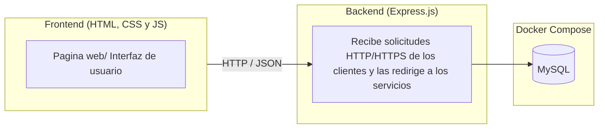
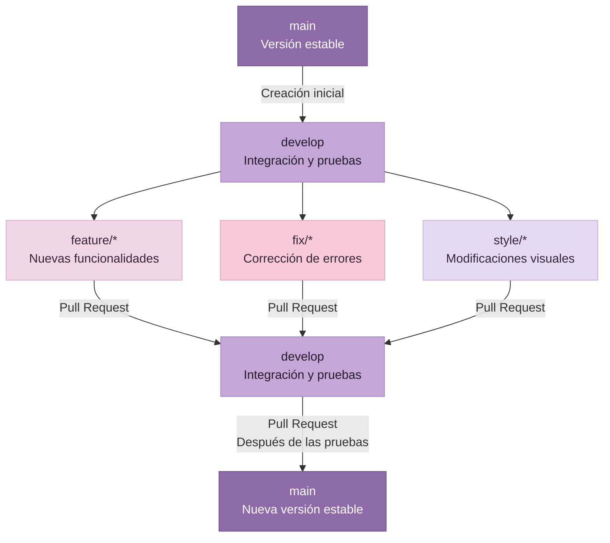

# Proyecto_SED_02-26

# Descripcion: 
La página web desarrollada consiste en una plataforma de comercio electrónico enfocada en la compra y venta de ropa de segunda mano, cuyo principal objetivo es la reducción del desperdicio textil mediante la reutilización de prendas en buen estado que ya no son utilizadas por sus propietarios.

La plataforma permite que los usuarios participen tanto como vendedores y compradores, ofreciendo un espacio digital accesible en el que puedan publicar, consultar y adquirir diferentes prendas de vestir.

Para realizar ventas, los usuarios deben registrarse e iniciar sesión en la plataforma. Posteriormente, pueden acceder a la sección de productos y completar un formulario en el que proporcionan información relevante sobre las prendas que desean ofrecer y una imagen representativa del producto.

Por otra parte, los usuarios interesados en adquirir ropa pueden explorar el catálogo disponible, consultar las características de cada producto y agregarlos a un carrito de compras. Una vez seleccionados los artículos se procede con el proceso de compra donde se genera una factura que detalla los productos adquiridos y el monto total de la operación.


El sistema incluye los siguientes __roles:__
1. *Usuario publico:* accede a la pagina sin necesidad de registrarse o de inciar sesión, puede visualizar de forma general el sitio y consultar información básica.
2. *Vendedor:* tiene acceso a funcionalidades de compra y venta; puede publicar ropa a partir de un formulario donde proporciona especificaciones del producto, agregar al carrito de compras y realizar pedidos.
3. *Admin:* tiene acceso a funcionalidades adminsitrativas que le permite supervisar y gestionar su funcionamiento. Se encarga de administrar usuarios, gestión de productos y control de la inforamción almacenada en el sistema.

# Arquitectura:



1. __Tecnologias:__ 
Express.js, Node.js, Docker, Javascript

2. __Base de datos:__ MySQL

3. __Estructura carpetas:__
```text
proyecto
├── 📁 backend/
│   ├── ⚙️ config/
│   │   └── database.js
│   ├── 🎮 controllers/
│   │   ├── adminController.js
│   │   ├── carritoController.js
│   │   ├── pedidosController.js
│   │   ├── productosController.js
│   │   ├── stockController.js
│   │   └── validacionProducto.js
│   ├──  🗃️  db/
│   │   ├── migracion_roles.sql
│   │   ├── pedidos_factura.sql
│   │   └── tienda_ropa.sql
│   ├── 🛡️ middleware/
│   │   ├── auth.js
│   │   └── upload.js
│   ├── 🛣️ routes/
│   │   ├── admin.js
│   │   ├── carrito.js
│   │   ├── pedidos.js
│   │   ├── productos.js
│   │   └── stocke.js
│   └── 🔧 scripts/
│       └── crear-admin.js
│
├── 🎨 frontend/
│   ├── 🖼️ assets/
│   │   ├── 🔣 icons/
│   │   │   ├── footer/
│   │   │   │   ├── facebook.svg
│   │   │   │   ├── instagram.svg
│   │   │   │   └── pinterest.svg
│   │   │   ├── home/
│   │   │   │   └── add-cart.svg
│   │   │   ├── navigation/
│   │   │   │   ├── cart.svg
│   │   │   │   ├── search.svg
│   │   │   │   └── user.svg
│   │   │   ├── sell-page/
│   │   │   │   └── user.svg
│   │   │   ├── sell-panel/
│   │   │   │   ├── create.svg
│   │   │   │   ├── dashboard.svg
│   │   │   │   ├── edit-profile.svg
│   │   │   │   └── stock.svg
│   │   │   ├── shoppingCart/
│   │   │   │   ├── cart-arrow.svg
│   │   │   │   ├── cart-check.svg
│   │   │   │   ├── cart-plus.svg
│   │   │   │   ├── cart.svg
│   │   │   │   └── trash.svg
│   │   │   └── .gitkeep
│   │   └── 🌄 images/
│   │       ├── banner/
│   │       │   ├── banner1.jpg
│   │       │   ├── banner2.jpg
│   │       │   └── banner3.jpg
│   │       ├── home/
│   │       │   ├── hero1.jpg
│   │       │   └── hero2.jpg
│   │       ├── logo/
│   │       │   ├── logo-loop-horizontal.svg
│   │       │   └── logo-loop.svg
│   │       └── .gitkeep
│   │
│   ├── 💅 css/
│   │   ├── general/
│   │   │   ├── footer.css
│   │   │   └── header.css
│   │   ├── login/
│   │   │   └── style_login.css
│   │   ├── main/
│   │   │   ├── home.css
│   │   │   └── product.css
│   │   ├── sell/
│   │   │   └── vender.css
│   │   ├── seller-styles/
│   │   │   ├── item-register-page.css
│   │   │   ├── panel.css
│   │   │   └── stock.css
│   │   ├── shared/
│   │   │   ├── components.css
│   │   │   └── productos.css
│   │   ├── shoppingCart/
│   │   │   ├── cart.css
│   │   │   └── receipt.css
│   │   └── .gitkeep
│   │
│   ├── ⚡ js/
│   │   ├── admin/
│   │   │   └── panel.js
│   │   ├── data/
│   │   │   └── mockProducts.js
│   │   ├── frontend-common/
│   │   │   └── components.js
│   │   ├── general/
│   │   │   ├── product-utils.js
│   │   │   ├── reuse.js
│   │   │   └── session.js
│   │   ├── login/
│   │   │   ├── script_login.js
│   │   │   └── script_registro.js
│   │   ├── main/
│   │   │   ├── home.js
│   │   │   └── product.js
│   │   ├── product-registration/
│   │   │   └── item-register-page.js
│   │   ├── sell/
│   │   │   └── carousel.js
│   │   ├── seller/
│   │   │   ├── panel.js
│   │   │   └── stock.js
│   │   ├── shared/
│   │   │   └── productos.js
│   │   ├── shoppingCart/
│   │   │   ├── cart.js
│   │   │   ├── cartService.js
│   │   │   └── receipt.js
│   │   └── .gitkeep
│   │
│   ├── 📄 modules/
│   │   ├── admin/
│   │   │   └── panel.html
│   │   ├── components/
│   │   │   ├── footer.html
│   │   │   └── navbar.html
│   │   ├── general/
│   │   │   ├── footer.html
│   │   │   └── header.html
│   │   ├── login/
│   │   │   ├── index_login.html
│   │   │   └── registro.html
│   │   ├── productDetail/
│   │   │   └── product.js
│   │   ├── sell/
│   │   │   └── sell.html
│   │   ├── seller/
│   │   │   ├── item-register-form.html
│   │   │   ├── panel.html
│   │   │   └── stoc.html
│   │   ├── shoppingCart/
│   │   │   ├── cart.html
│   │   │   └── receipt.html
│   │   └── .gitkeep
│   │
│   ├── index.html
│   ├── .gitignore
│   └── README.md
│
├── .env.example
├── .gitattributes
├── .npmrc
├── app.js
├── 🐳 docker-compose.yml
├── package-lock.json
├── package.json
└── server.js
```


# 6. Flujo de trabajo en GitHub (Git Flow)

Para el desarrollo colaborativo del proyecto se utilizó **GitHub como plataforma de alojamiento y gestión del repositorio**, implementando una adaptación de la metodología **Git Flow** para organizar el trabajo del equipo, controlar los cambios y mantener una versión estable de la aplicación.

El flujo de trabajo se estructuró mediante diferentes tipos de ramas, cada una con una responsabilidad específica.

### Estructura de ramas

Se definieron las siguientes ramas:

| Rama | Descripción |
|---|---|
| `main` | Contiene la versión estable del proyecto. Los cambios que llegan a esta rama han pasado previamente por el proceso de integración y pruebas en `develop`. |
| `develop` | Rama principal de integración. Recibe los cambios provenientes de las ramas secundarias mediante Pull Requests. También funciona como rama de pruebas antes de incorporar los cambios a `main`. |
| `feature/*` | Ramas destinadas al desarrollo e implementación de nuevas funcionalidades del sistema. Se crean a partir de `develop`. |
| `fix/*` | Ramas destinadas a corregir errores o bugs identificados durante las pruebas y el desarrollo del proyecto. |
| `style/*` | Ramas destinadas a realizar modificaciones relacionadas con la presentación visual, estilos CSS, diseño y organización de los componentes de la interfaz. |

### Creación y utilización de las ramas

El trabajo se inició creando la rama `develop` a partir de `main`. Posteriormente, el desarrollo de nuevas funcionalidades y modificaciones se realizó mediante ramas secundarias creadas a partir de `develop`.

Cada integrante del equipo trabajó en una rama independiente, según la tarea asignada.

**Ejemplos de nombres de ramas:**

- `feature/index`
- `feature/previewForm`
- `fix/imagenes-productos`
- `style/general`


### Integración de cambios mediante Pull Requests

La integración de los cambios se realizó utilizando **Pull Requests (PR) de GitHub**, evitando incorporar directamente modificaciones a las ramas principales.

El procedimiento establecido fue el siguiente:

1. El integrante crea una rama secundaria (`feature/*`, `fix/*` o `style/*`) a partir de `develop`.
2. Desarrolla la funcionalidad, corrección o modificación correspondiente.
3. Realiza commits con los cambios implementados y los publica en GitHub.
4. Crea un Pull Request estableciendo como rama de origen su rama de trabajo y como rama de destino `develop`.
5. El equipo revisa los cambios y, si son correctos, aprueba e integra el Pull Request.
6. Los cambios integrados en `develop` se someten a pruebas para verificar su funcionamiento y evitar que afecten otras funcionalidades del sistema.

### Publicación de versiones estables

Una vez que los cambios integrados en `develop` han sido revisados y las pruebas correspondientes han finalizado satisfactoriamente, se procede a incorporar las modificaciones a `main`.

Para ello, se crea un Pull Request cuya rama de origen es `develop` y cuya rama de destino es `main`.

Este procedimiento permite que `main` conserve únicamente versiones estables del proyecto, mientras que `develop` mantiene la versión de integración y pruebas del equipo.

### Diagrama del flujo de trabajo

El siguiente diagrama representa el proceso de creación de ramas, desarrollo de funcionalidades, integración y publicación de versiones estables:



**Nota:** Todas las ramas secundarias se crean a partir de `develop` y sus cambios se integran nuevamente mediante Pull Requests. La rama `main` recibe los cambios únicamente después de completar el proceso de integración y pruebas en `develop`.

### Beneficios del flujo implementado

La utilización de Git Flow y GitHub permitió:

- **Organización del trabajo:** cada integrante pudo desarrollar funcionalidades o realizar correcciones de manera independiente.
- **Separación de responsabilidades:** se diferenciaron los cambios funcionales, las correcciones de errores y las modificaciones visuales.
- **Control de cambios:** los Pull Requests permitieron revisar las modificaciones antes de integrarlas al proyecto.
- **Prevención de conflictos:** el trabajo mediante ramas independientes redujo las modificaciones simultáneas sobre los mismos archivos.
- **Estabilidad del proyecto:** la rama `main` se mantuvo como referencia de la versión estable, mientras que `develop` permitió integrar y probar los cambios antes de su publicación.