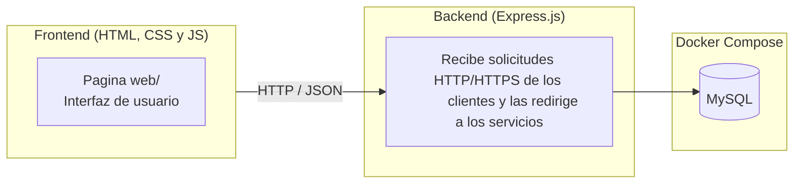

# Proyecto_SED_02-26

# Descripcion: 
La página web desarrollada consiste en una plataforma de comercio electrónico enfocada en la compra y venta de ropa de segunda mano, cuyo principal objetivo es la reducción del desperdicio textil mediante la reutilización de prendas en buen estado que ya no son utilizadas por sus propietarios.

La plataforma permite que los usuarios participen tanto como vendedores y compradores, ofreciendo un espacio digital accesible en el que puedan publicar, consultar y adquirir diferentes prendas de vestir.

Para realizar ventas, los usuarios deben registrarse e iniciar sesión en la plataforma. Posteriormente, pueden acceder a la sección de productos y completar un formulario en el que proporcionan información relevante sobre las prendas que desean ofrecer y una imagen representativa del producto.

Por otra parte, los usuarios interesados en adquirir ropa pueden explorar el catálogo disponible, consultar las características de cada producto y agregarlos a un carrito de compras. Una vez seleccionados los artículos se procede con el proceso de compra donde se genera una factura que detalla los productos adquiridos y el monto total de la operación.


El sistema incluye los siguientes __roles:__
1. *Usuario publico:* accede a la pagina sin necesidad de registrarse o de inciar sesión, puede visualizar de forma general el sitio y consultar información básica.
2. *Vendedor:* tiene acceso a funcionalidades de compra y venta; puede publicar ropa a partir de un formulario donde proporciona especificaciones del producto, agregar al carrito de compras y realizar pedidos.
3. *Admin:* tiene acceso a funcionalidades adminsitrativas que le permite supervisar y gestionar su funcionamiento. Se encarga de administrar usuarios, gestión de productos y control de la inforamción almacenada en el sistema.

# Arquitectura:



1. __Tecnologias:__ 
Express.js, Node.js, Docker, Javascript

2. __Base de datos:__ MySQL

3. __Estructura carpetas:__
```text
proyecto
├── 📁 backend/
│   ├── ⚙️ config/
│   │   └── database.js
│   ├── 🎮 controllers/
│   │   ├── adminController.js
│   │   ├── carritoController.js
│   │   ├── pedidosController.js
│   │   ├── productosController.js
│   │   ├── stockController.js
│   │   └── validacionProducto.js
│   ├──  🗃️  db/
│   │   ├── migracion_roles.sql
│   │   ├── pedidos_factura.sql
│   │   └── tienda_ropa.sql
│   ├── 🛡️ middleware/
│   │   ├── auth.js
│   │   └── upload.js
│   ├── 🛣️ routes/
│   │   ├── admin.js
│   │   ├── carrito.js
│   │   ├── pedidos.js
│   │   ├── productos.js
│   │   └── stocke.js
│   └── 🔧 scripts/
│       └── crear-admin.js
│
├── 🎨 frontend/
│   ├── 🖼️ assets/
│   │   ├── 🔣 icons/
│   │   │   ├── footer/
│   │   │   │   ├── facebook.svg
│   │   │   │   ├── instagram.svg
│   │   │   │   └── pinterest.svg
│   │   │   ├── home/
│   │   │   │   └── add-cart.svg
│   │   │   ├── navigation/
│   │   │   │   ├── cart.svg
│   │   │   │   ├── search.svg
│   │   │   │   └── user.svg
│   │   │   ├── sell-page/
│   │   │   │   └── user.svg
│   │   │   ├── sell-panel/
│   │   │   │   ├── create.svg
│   │   │   │   ├── dashboard.svg
│   │   │   │   ├── edit-profile.svg
│   │   │   │   └── stock.svg
│   │   │   ├── shoppingCart/
│   │   │   │   ├── cart-arrow.svg
│   │   │   │   ├── cart-check.svg
│   │   │   │   ├── cart-plus.svg
│   │   │   │   ├── cart.svg
│   │   │   │   └── trash.svg
│   │   │   └── .gitkeep
│   │   └── 🌄 images/
│   │       ├── banner/
│   │       │   ├── banner1.jpg
│   │       │   ├── banner2.jpg
│   │       │   └── banner3.jpg
│   │       ├── home/
│   │       │   ├── hero1.jpg
│   │       │   └── hero2.jpg
│   │       ├── logo/
│   │       │   ├── logo-loop-horizontal.svg
│   │       │   └── logo-loop.svg
│   │       └── .gitkeep
│   │
│   ├── 💅 css/
│   │   ├── general/
│   │   │   ├── footer.css
│   │   │   └── header.css
│   │   ├── login/
│   │   │   └── style_login.css
│   │   ├── main/
│   │   │   ├── home.css
│   │   │   └── product.css
│   │   ├── sell/
│   │   │   └── vender.css
│   │   ├── seller-styles/
│   │   │   ├── item-register-page.css
│   │   │   ├── panel.css
│   │   │   └── stock.css
│   │   ├── shared/
│   │   │   ├── components.css
│   │   │   └── productos.css
│   │   ├── shoppingCart/
│   │   │   ├── cart.css
│   │   │   └── receipt.css
│   │   └── .gitkeep
│   │
│   ├── ⚡ js/
│   │   ├── admin/
│   │   │   └── panel.js
│   │   ├── data/
│   │   │   └── mockProducts.js
│   │   ├── frontend-common/
│   │   │   └── components.js
│   │   ├── general/
│   │   │   ├── product-utils.js
│   │   │   ├── reuse.js
│   │   │   └── session.js
│   │   ├── login/
│   │   │   ├── script_login.js
│   │   │   └── script_registro.js
│   │   ├── main/
│   │   │   ├── home.js
│   │   │   └── product.js
│   │   ├── product-registration/
│   │   │   └── item-register-page.js
│   │   ├── sell/
│   │   │   └── carousel.js
│   │   ├── seller/
│   │   │   ├── panel.js
│   │   │   └── stock.js
│   │   ├── shared/
│   │   │   └── productos.js
│   │   ├── shoppingCart/
│   │   │   ├── cart.js
│   │   │   ├── cartService.js
│   │   │   └── receipt.js
│   │   └── .gitkeep
│   │
│   ├── 📄 modules/
│   │   ├── admin/
│   │   │   └── panel.html
│   │   ├── components/
│   │   │   ├── footer.html
│   │   │   └── navbar.html
│   │   ├── general/
│   │   │   ├── footer.html
│   │   │   └── header.html
│   │   ├── login/
│   │   │   ├── index_login.html
│   │   │   └── registro.html
│   │   ├── productDetail/
│   │   │   └── product.js
│   │   ├── sell/
│   │   │   └── sell.html
│   │   ├── seller/
│   │   │   ├── item-register-form.html
│   │   │   ├── panel.html
│   │   │   └── stoc.html
│   │   ├── shoppingCart/
│   │   │   ├── cart.html
│   │   │   └── receipt.html
│   │   └── .gitkeep
│   │
│   ├── index.html
│   ├── .gitignore
│   └── README.md
│
├── .env.example
├── .gitattributes
├── .npmrc
├── app.js
├── 🐳 docker-compose.yml
├── package-lock.json
├── package.json
└── server.js
```